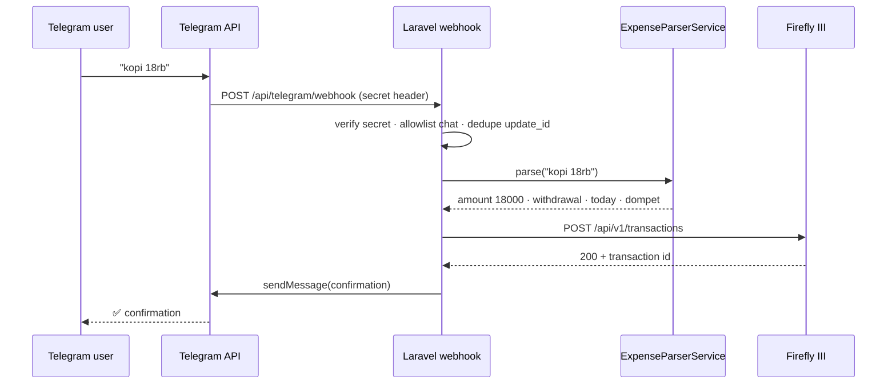

<p align="center">
  
  
  
  
  
  
</p>

<h1 align="center">Telegram Finance Bot</h1>

<p align="center">
  Log income and expenses from a single Telegram message in plain Indonesian — the bot parses it, writes a double-entry transaction into <a href="https://www.firefly-iii.org/">Firefly III</a>, and replies with a confirmation.
</p>

---

## Why this exists

Opening a finance app to record "kopi 18rb" is friction. This bot keeps the ledger in Firefly III (the source of truth) while the input is just a chat message:

```text
you  > makan siang 25000
bot  > Transaksi Berhasil Dicatat!
       • Jenis: Pengeluaran
       • Deskripsi: makan siang
       • Jumlah: Rp 25.000
       • Tanggal: 27 Okt 2026
       • Sumber: dompet

you  > +5000000 Gaji
bot  > Transaksi Berhasil Dicatat!   # deposit / income

you  > /undo
bot  > ✅ Transaksi terakhir (ID: 1234) berhasil dihapus dari Firefly III.
```

## ✨ Features

| Feature | Detail |
|---|---|
| **Natural-language parsing** | Amounts: `25000`, `Rp 35.000`, `40rb`, `1,5jt`, `25k`. Dates: `hari ini`, `kemarin`, `kemarin lusa`, `3 sept`, `3/9`, `3/9/2025` (future dates without a year roll back). |
| **Income vs expense** | A leading `+` marks a deposit; everything else is a withdrawal. |
| **Source account detection** | `tf` / `trf` / `transfer` / `qris` → `Mandiri`; otherwise `dompet`. |
| **Firefly III sync** | Creates real transactions through `/api/v1/transactions` (`apply_rules` + `fire_webhooks` enabled). |
| **`/undo`** | Deletes the last transaction created through the bot (cached for 1 hour per chat). |
| **Webhook security** | Verifies Telegram's `X-Telegram-Bot-Api-Secret-Token` header, enforces a chat-id allowlist, and deduplicates `update_id` for 24 h. |
| **Graceful failures** | Friendly Telegram replies for unparseable text, Firefly HTTP errors and connection errors (no silent failures). |

## 🔄 Flow



## 🚀 Getting started

**Requirements:** PHP 8.3+, Composer, a running [Firefly III](https://docs.firefly-iii.org/how-to/firefly-iii/installation/docker/) instance, and a Telegram bot token from [@BotFather](https://t.me/BotFather).

```bash
composer install
cp .env.example .env
php artisan key:generate
php artisan migrate
```

### Environment

| Variable | Description |
|---|---|
| `TELEGRAM_BOT_TOKEN` | Bot token from BotFather. |
| `TELEGRAM_WEBHOOK_SECRET` | Random string; sent by Telegram as `X-Telegram-Bot-Api-Secret-Token`. |
| `TELEGRAM_ALLOWED_CHAT_ID` | Only this chat may use the bot (strongly recommended). |
| `FIREFLY_URL` | Base URL of your Firefly III instance, e.g. `http://localhost:8080`. |
| `FIREFLY_PERSONAL_ACCESS_TOKEN` | Firefly III → Profile → OAuth → Personal Access Token. |
| `FIREFLY_DEFAULT_SOURCE_NAME` | Asset account used for expenses (default `Cash`). |
| `FIREFLY_DEFAULT_REVENUE_NAME` | Revenue account used for deposits (default `Income`). |

> The parser sends account names `dompet` and `Mandiri` (see `ExpenseParserService::extractSourceAccount()`); create those asset accounts in Firefly III or adjust the keyword map.

### Register the webhook

```bash
curl "https://api.telegram.org/bot<BOT_TOKEN>/setWebhook" \
  -d "url=https://your-domain.test/api/telegram/webhook" \
  -d "secret_token=<TELEGRAM_WEBHOOK_SECRET>"

# check it
curl "https://api.telegram.org/bot<BOT_TOKEN>/getWebhookInfo"
```

The endpoint must be publicly reachable over HTTPS (ngrok / Cloudflare Tunnel is fine for local development).

## 📚 Documentation

- [API reference](docs/API.md): webhook endpoint, Firefly III and Telegram calls, message grammar, error handling, security notes.
- [Product requirements](docs/PRD.md): goals, scope, requirements, and implementation status.

## 🧪 Tests

```bash
php artisan test
```

**31 tests** cover amount/date/source parsing, the Firefly III client (`Http::fake()`), the Telegram client, and the webhook (secret validation, chat allowlist, `update_id` dedupe, `/undo`, upstream errors).

## 🏗️ Structure

```
app/
├── Http/Controllers/TelegramWebhookController.php  # verify → parse → Firefly → reply
├── Services/
│   ├── ExpenseParserService.php                    # Indonesian NLP (amount, date, account, type)
│   ├── FireflyService.php                          # create / delete transactions
│   └── TelegramService.php                         # sendMessage
routes/api.php                                      # POST /api/telegram/webhook
```

## ⚠️ Notes & limitations

- Natural-language parsing is tuned for **Indonesian** and simple `description + amount` messages.
- The account mapping (`tf/qris → Mandiri`) is a small keyword map — edit it to match your own accounts.
- Deduplication uses the cache store, so use a shared store (`database`, `redis`, …) when running more than one instance.
- Firefly III remains the source of truth; this app stores no ledger of its own.

## 📄 License

MIT — see [LICENSE](LICENSE).
