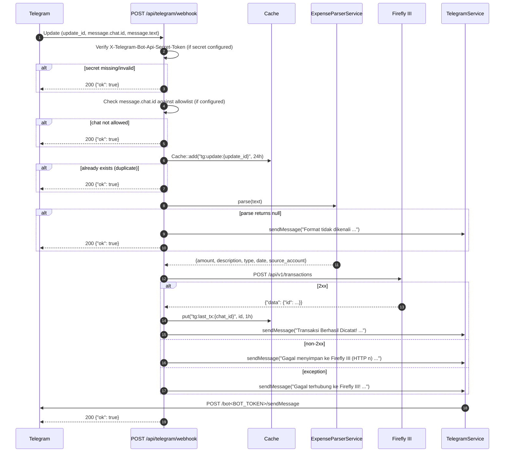
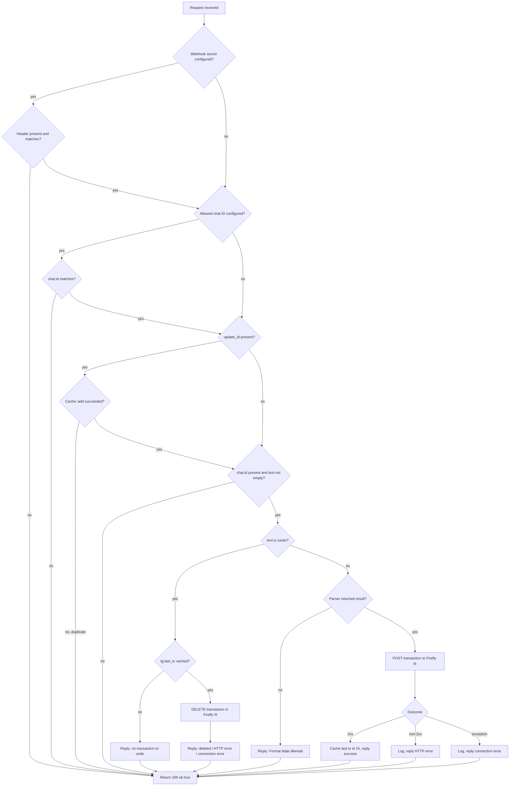

# Telegram Finance Bot — API Reference

> Every statement in this document is derived from the source code or the test suite. Source references are given as `file:line`. Items that do not exist in the codebase are marked **Not implemented**.

## 1. Overview

The application exposes a single inbound HTTP endpoint that receives Telegram Bot API updates (webhook mode). Each update containing a text message is checked against an optional shared secret, an optional chat allowlist, and an `update_id` de-duplication cache. The message text is then parsed by `ExpenseParserService` into a transaction (amount, description, type, date, source account), stored in Firefly III through its REST API, and confirmed back to the user via the Telegram `sendMessage` method. A `/undo` command deletes the most recent transaction created from the same chat within the last hour. The endpoint always answers Telegram with HTTP `200` and `{"ok": true}`; outcomes are communicated to the user through Telegram replies, not through the HTTP response.

### Endpoints

| Method | Path | Handler |
|---|---|---|
| `POST` | `/api/telegram/webhook` | `TelegramWebhookController@handle` (`routes/api.php:6`) |

The `/api` prefix comes from the `api:` routing registration in `bootstrap/app.php:11`.

---

## 2. Endpoint reference: `POST /api/telegram/webhook`

### 2.1 Authentication and middleware

- No Laravel auth middleware is attached to the route (`routes/api.php:6`, `bootstrap/app.php:15-17`).
- Access control is performed inside the controller via the secret header and chat allowlist (see 2.2 and section 8).
- Rate limiting: **Not implemented** (no throttle middleware is configured).

### 2.2 Request headers

| Header | Required | Description | Behaviour when missing or wrong |
|---|---|---|---|
| `X-Telegram-Bot-Api-Secret-Token` | Required **only if** `TELEGRAM_WEBHOOK_SECRET` is set | Compared to `services.telegram.webhook_secret` with `hash_equals()` (`TelegramWebhookController.php:24-27`). | Missing or mismatched value: a warning `Telegram webhook request ignored: invalid secret token` is logged and the controller returns `200 {"ok": true}` immediately. No call is made to Firefly III or Telegram. If `TELEGRAM_WEBHOOK_SECRET` is empty, the check is skipped entirely. |
| `Content-Type` | Not validated by the controller | The body is read with `$request->input()` (`TelegramWebhookController.php:34,43,53`). All tests send `application/json` (`postJson`). | No explicit validation exists. Behaviour with other content types is not covered by tests. |

### 2.3 Request body

The controller reads only the following fields from the Telegram `Update` object. All other fields are ignored.

| Field | Type | Description | Source |
|---|---|---|---|
| `update_id` | integer | Used as the de-duplication key `tg:update:{update_id}`. If absent or falsy (e.g. `0`), de-duplication is skipped. | `TelegramWebhookController.php:43-51` |
| `message.chat.id` | integer \| string | Chat identifier. Compared (as string) to the allowlist; used as the reply target and as the `/undo` cache key. | `TelegramWebhookController.php:34-41` |
| `message.text` | string | Message text. Trimmed before use. If empty or missing, the request is acknowledged without a reply. | `TelegramWebhookController.php:53-57` |

Minimal payload (shape taken from `tests/Feature/TelegramWebhookControllerTest.php`):

```json
{
  "update_id": 1,
  "message": {
    "chat": { "id": 123456789 },
    "text": "Makan siang 25000"
  }
}
```

> `123456789` is the placeholder chat ID used in the test suite, not a real chat.

Updates without a `message` object (for example `edited_message` or `callback_query`) are not handled: the chat ID resolves to `null`. If an allowlist is configured, such updates are rejected by the allowlist check; otherwise they are acknowledged with no action. Support for other update types: **Not implemented**.

### 2.4 Responses

The HTTP response is always `200 OK` with the body below. This includes the case where an unexpected exception occurs, because the whole handler is wrapped in `try/catch (\Throwable)` and falls through to the final return (`TelegramWebhookController.php:111-115`).

```json
{ "ok": true }
```

The cases differ only in side effects (Telegram reply, Firefly III call, log entry):

| Case | HTTP status | Body | Outbound calls | Telegram reply text (prefix) | Test |
|---|---|---|---|---|---|
| Success (transaction stored) | `200` | `{"ok": true}` | Firefly `POST /api/v1/transactions`, then Telegram `sendMessage` | `Transaksi Berhasil Dicatat!` | `test_processes_valid_request_with_valid_secret_and_chat_id`, `test_webhook_displays_source_account_in_confirmation_message` |
| Wrong or missing secret | `200` | `{"ok": true}` | None | None | `test_ignores_request_with_invalid_secret_token` (wrong value only) |
| Chat not in allowlist | `200` | `{"ok": true}` | None | None | `test_ignores_request_from_unauthorized_chat_id` |
| Duplicate `update_id` | `200` | `{"ok": true}` | None for the duplicate | None | `test_deduplicates_duplicate_update_id` |
| Empty text / no chat ID | `200` | `{"ok": true}` | None | None | Not covered by tests (code: `TelegramWebhookController.php:55-57`) |
| Unparseable message | `200` | `{"ok": true}` | Telegram `sendMessage` only | `Format tidak dikenali.` | `test_handles_unparseable_text_returns_200_and_error_message` |
| `/undo` with cached transaction | `200` | `{"ok": true}` | Firefly `DELETE /api/v1/transactions/{id}`, then Telegram `sendMessage` | `✅ Transaksi terakhir (ID: {id}) berhasil dihapus dari Firefly III.` | `test_undo_command_deletes_cached_transaction` |
| `/undo` without cached transaction | `200` | `{"ok": true}` | Telegram `sendMessage` only | `Tidak ada transaksi terakhir yang dapat di-undo ...` | `test_undo_command_without_cached_transaction_replies_error` |
| `/undo`, Firefly returns non-2xx | `200` | `{"ok": true}` | Firefly `DELETE`, Telegram `sendMessage` | `Gagal menghapus transaksi di Firefly III (HTTP {status}).` | Not covered by tests (code: `TelegramWebhookController.php:141-151`) |
| `/undo`, connection failure | `200` | `{"ok": true}` | Telegram `sendMessage` | `Gagal terhubung ke Firefly III saat mencoba menghapus transaksi.` | Not covered by tests (code: `TelegramWebhookController.php:152-158`) |
| Firefly III returns non-2xx on store | `200` | `{"ok": true}` | Firefly `POST`, Telegram `sendMessage` | `Gagal menyimpan ke Firefly III (HTTP {status}).` | `test_handles_firefly_500_error_returns_200_and_failure_message` (HTTP 500) |
| Connection failure on store | `200` | `{"ok": true}` | Telegram `sendMessage` | `Gagal terhubung ke Firefly III!` | Not covered by tests (code: `TelegramWebhookController.php:103-110`) |

### 2.5 Example request

```bash
curl -X POST "https://<APP_HOST>/api/telegram/webhook" \
  -H "Content-Type: application/json" \
  -H "X-Telegram-Bot-Api-Secret-Token: <WEBHOOK_SECRET>" \
  -d '{
        "update_id": <UPDATE_ID>,
        "message": {
          "chat": { "id": <CHAT_ID> },
          "text": "Makan siang 25000"
        }
      }'
```

Expected response:

```json
{ "ok": true }
```

Registering the webhook with Telegram (`setWebhook`) is **Not implemented** in this repository; it must be done outside the application.

---

## 3. Outbound call: Firefly III

Implemented in `app/Services/FireflyService.php`.

### 3.1 Configuration

| Config key | Env variable | Default | Source |
|---|---|---|---|
| `services.firefly.url` | `FIREFLY_URL` | `http://localhost:8080` (trailing `/` stripped) | `config/services.php:45` |
| `services.firefly.token` | `FIREFLY_PERSONAL_ACCESS_TOKEN` | none | `config/services.php:46` |
| `services.firefly.default_source` | `FIREFLY_DEFAULT_SOURCE_NAME` | `Cash` | `config/services.php:47` |
| `services.firefly.default_revenue` | `FIREFLY_DEFAULT_REVENUE_NAME` | `Income` | `config/services.php:48` |

### 3.2 Create transaction

| Property | Value |
|---|---|
| Method | `POST` |
| URL | `{FIREFLY_URL}/api/v1/transactions` |
| Headers | `Authorization: Bearer <FIREFLY_PERSONAL_ACCESS_TOKEN>`, `Accept: application/json`, `Content-Type: application/json` |
| Source | `FireflyService.php:44-51` |

Top-level payload fields:

| Field | Value | Description |
|---|---|---|
| `apply_rules` | `true` (hard-coded) | Asks Firefly III to apply its rule engine to the new transaction. |
| `fire_webhooks` | `true` (hard-coded) | Asks Firefly III to fire its configured webhooks for the new transaction. |
| `transactions` | array with exactly one item | The transaction split (see below). |

Transaction item fields (`FireflyService.php:30-42`):

| Field | Type | Withdrawal | Deposit |
|---|---|---|---|
| `type` | string | `withdrawal` | `deposit` |
| `date` | string (ISO 8601) | Parsed date, or current time if none | same |
| `amount` | string | Amount cast to string (e.g. `"25000"`) | same |
| `description` | string | Parsed description | same |
| `source_name` | string | Source account | `FIREFLY_DEFAULT_REVENUE_NAME` (default `Income`) |
| `destination_name` | string | not sent | Source account |

"Source account" is `source_account` from the parser. It falls back to `FIREFLY_DEFAULT_SOURCE_NAME` only when the key is absent from the input array (`FireflyService.php:20`). Because `ExpenseParserService` always sets `source_account` (`Mandiri` or `dompet`, see section 5.4), the configured default is used only when `FireflyService` is called directly, as in `tests/Unit/FireflyServiceTest.php`.

Withdrawal example (values from `test_stores_withdrawal_transaction`; date shown as a placeholder):

```json
{
  "apply_rules": true,
  "fire_webhooks": true,
  "transactions": [
    {
      "type": "withdrawal",
      "date": "<ISO_8601_DATETIME>",
      "amount": "25000",
      "description": "Makan siang",
      "source_name": "Cash"
    }
  ]
}
```

Deposit example (values from `test_stores_deposit_transaction`):

```json
{
  "apply_rules": true,
  "fire_webhooks": true,
  "transactions": [
    {
      "type": "deposit",
      "date": "<ISO_8601_DATETIME>",
      "amount": "5000000",
      "description": "Gaji",
      "destination_name": "Cash",
      "source_name": "Income"
    }
  ]
}
```

Response handling:

- The only field read from the response is `data.id` (`TelegramWebhookController.php:78`). The test fixture uses the minimal shape below; the full Firefly III response schema is not used by this application.

  ```json
  { "data": { "id": "1" } }
  ```

- If `data.id` is present, it is cached as `tg:last_tx:{chat_id}` for 1 hour to support `/undo` (`TelegramWebhookController.php:79-81`).

### 3.3 Delete transaction (used by `/undo`)

| Property | Value |
|---|---|
| Method | `DELETE` |
| URL | `{FIREFLY_URL}/api/v1/transactions/{id}` |
| Headers | `Authorization: Bearer <FIREFLY_PERSONAL_ACCESS_TOKEN>`, `Accept: application/json` |
| Body | none |
| Source | `FireflyService.php:57-65` |

The test fixture responds with `204 No Content` (`test_undo_command_deletes_cached_transaction`). Any 2xx response is treated as success.

### 3.4 Error handling

| Condition | Detection | Behaviour |
|---|---|---|
| Non-2xx response on create | `!$response->successful()` | Logs `Firefly III API Error` with `status` and `body`; replies `Gagal menyimpan ke Firefly III (HTTP {status}).` (`TelegramWebhookController.php:92-101`) |
| Exception on create (e.g. connection refused) | `catch (\Throwable)` | Logs `Firefly III Connection Error`; replies `Gagal terhubung ke Firefly III!` including the configured `FIREFLY_URL` (`TelegramWebhookController.php:103-110`) |
| Non-2xx response on delete | `!$response->successful()` | Logs `Firefly III Delete API Error`; replies `Gagal menghapus transaksi di Firefly III (HTTP {status}).` Cache entry is kept. |
| Exception on delete | `catch (\Throwable)` | Logs `Firefly III Delete Connection Error`; replies `Gagal terhubung ke Firefly III saat mencoba menghapus transaksi.` |
| Retries | — | **Not implemented** |
| Explicit timeout | — | **Not implemented** (HTTP client defaults apply) |

---

## 4. Outbound call: Telegram `sendMessage`

Implemented in `app/Services/TelegramService.php`.

| Property | Value |
|---|---|
| Method | `POST` |
| URL | `https://api.telegram.org/bot<BOT_TOKEN>/sendMessage` |
| Token source | `services.telegram.bot_token` ← `TELEGRAM_BOT_TOKEN` (`config/services.php:39`) |
| Body (JSON) | `chat_id`, `text` |
| `parse_mode` | Not sent. Messages are plain text, so backticks in replies are shown literally. |
| Response handling | The response is returned to the caller but never inspected by the controller. |

Payload (values from `tests/Unit/TelegramServiceTest.php`):

```json
{
  "chat_id": 123456,
  "text": "Pesan dari bot"
}
```

Equivalent curl call:

```bash
curl -X POST "https://api.telegram.org/bot<BOT_TOKEN>/sendMessage" \
  -H "Content-Type: application/json" \
  -d '{"chat_id": <CHAT_ID>, "text": "Pesan dari bot"}'
```

### 4.1 Reply formats

Success (`TelegramWebhookController.php:83-91`):

```text
Transaksi Berhasil Dicatat!

• Jenis: {Pengeluaran|Pemasukan}
• Deskripsi: {description}
• Jumlah: Rp {amount formatted with "." thousands separator, 0 decimals}
• Tanggal: {date formatted with translatedFormat('d M Y')}
• Sumber: {source_account}
```

- `Jenis` is `Pemasukan` for `deposit`, otherwise `Pengeluaran`.
- `Tanggal` month names depend on the application locale (`APP_LOCALE`, `en` in `.env.example`).
- `Sumber` shows the parser value as-is (`Mandiri` or `dompet`); `Dompet` is used only if the value is missing.

Unparseable message (`TelegramWebhookController.php:66-69`):

```text
Format tidak dikenali.

Contoh penggunaan:
• Pengeluaran: Makan siang 25000
• Pemasukan: +5000000 Gaji
```

Other replies are listed in the table in section 2.4.

---

## 5. Message grammar

Parsing is implemented in `app/Services/ExpenseParserService.php`. Processing order: deposit marker → date → source account keyword → amount → description (`ExpenseParserService.php:22-48`). Each recognised token is removed from the text; the remainder, with whitespace collapsed, becomes the description.

Parser output shape:

```php
['amount' => float, 'description' => string, 'type' => 'withdrawal'|'deposit', 'date' => 'Y-m-d', 'source_account' => string]
```

The parser returns `null` (→ "Format tidak dikenali" reply) when no amount greater than zero is found.

### 5.1 Examples (input → parse result)

All rows below are asserted in `tests/Unit/ExpenseParserServiceTest.php`, with "today" frozen at `2026-09-27`.

| Input | amount | description | type | date | source_account |
|---|---|---|---|---|---|
| `Makan siang 25000` | 25000 | `Makan siang` | withdrawal | 2026-09-27 | — |
| `Rp 50.000 Bensin` | 50000 | `Bensin` | withdrawal | — | — |
| `Kopi 25k` | 25000 | `Kopi` | withdrawal | — | — |
| `beli 2 galon 40rb` | 40000 | `beli 2 galon` | — | — | — |
| `beli 2 galon 40000` | 40000 | `beli 2 galon` | — | — | — |
| `1,5jt bayar sewa` | 1500000 | `bayar sewa` | — | — | — |
| `1.5jt bayar sewa` | 1500000 | `bayar sewa` | — | — | — |
| `+5000000 Gaji` | 5000000 | `Gaji` | deposit | — | — |
| `kemarin makan siang 25000` | — | `makan siang` | — | 2026-09-26 | — |
| `kemarin lusa beli bensin 35rb` | — | `beli bensin` | — | 2026-09-25 | — |
| `hari ini bayar listrik 150rb` | — | `bayar listrik` | — | 2026-09-27 | — |
| `3 sept beli bensin 35rb` | — | `beli bensin` | — | 2026-09-03 | — |
| `03-09 beli bensin 35rb` | — | `beli bensin` | — | 2026-09-03 | — |
| `3/9/2025 beli bensin 35rb` | — | `beli bensin` | — | 2025-09-03 | — |
| `10 des bayar servis 200rb` | — | `bayar servis` | — | 2025-12-10 | — |
| `tf beli sate 18rb` | — | `beli sate` | — | — | `Mandiri` |
| `qris main billiard 2 jam 200rb` | — | `main billiard 2 jam` | — | — | `Mandiri` |
| `trf bayar listrik 150rb` | — | `bayar listrik` | — | — | `Mandiri` |
| `60rb beli kertas` | — | `beli kertas` | — | — | `dompet` |
| `gorengan 10rb` | — | `gorengan` | — | — | `dompet` |
| `Hello world tanpa angka` | `null` (parse fails) | | | | |
| `halo bot` (via webhook) | `null` (parse fails) | | | | |

"—" means the test does not assert that field for that input.

### 5.2 Amount

| Form | Rule | Multiplier | Example (tested) |
|---|---|---|---|
| Plain integer | Fallback when no suffixed/prefixed amount exists. The **last** plain number is used; `.` and `,` are stripped. | 1 | `25000`, `beli 2 galon 40000` → 40000 |
| `Rp` / `Rp.` prefix | Prefixed number takes priority over plain numbers. `.` and `,` are stripped. | 1 | `Rp 50.000` → 50000 |
| `k`, `rb`, `ribu` suffix | Suffixed number takes priority. | 1,000 | `25k` → 25000, `40rb` → 40000 |
| `jt`, `juta` suffix | Suffixed number takes priority. | 1,000,000 | `1,5jt` → 1500000 |
| Decimal with suffix | With a multiplier, `,` is treated as a decimal separator; `.` is kept as decimal only when followed by 1–2 digits, otherwise stripped as a thousands separator. | — | `1.5jt` → 1500000 |

Source: `ExpenseParserService.php:80-115`, `207-234`. Amounts `<= 0` cause the parse to fail. Note: the `ribu` and `juta` suffixes are supported by the code but not covered by tests.

### 5.3 Transaction type

| Rule | Result | Source |
|---|---|---|
| Text contains `+` anywhere | `deposit`; every `+` is removed from the text | `ExpenseParserService.php:23-27` |
| Otherwise | `withdrawal` | same |

If the description is empty after extraction (e.g. input is only an amount), it defaults to `Pemasukan` (deposit) or `Pengeluaran` (withdrawal) (`ExpenseParserService.php:46-48`; not covered by tests).

### 5.4 Source account keywords

Matched case-insensitively as whole words, in this order; the first match wins and only that keyword is removed (`ExpenseParserService.php:59-78`).

| Keyword | `source_account` |
|---|---|
| `transfer` | `Mandiri` |
| `qris` | `Mandiri` |
| `trf` | `Mandiri` |
| `tf` | `Mandiri` |
| (none) | `dompet` |

Account names are hard-coded; configuring them via environment is **Not implemented**.

### 5.5 Date

Checked in this order; the first match wins (`ExpenseParserService.php:117-170`).

| Form | Result | Example (tested) |
|---|---|---|
| `kemarin lusa` | today − 2 days | `2026-09-25` |
| `kemarin` | today − 1 day | `2026-09-26` |
| `hari ini` | today | `2026-09-27` |
| `D <month> [YYYY]` | Given day/month (and year) | `3 sept` → `2026-09-03` |
| `D/M[/YYYY]` or `D-M[-YYYY]` | Day first, then month | `03-09` → `2026-09-03`, `3/9/2025` → `2025-09-03` |
| (none) | today | `Makan siang 25000` → `2026-09-27` |

Accepted month tokens (`ExpenseParserService.php:187-205`): `jan`, `januari`, `feb`, `februari`, `mar`, `maret`, `apr`, `april`, `mei`, `jun`, `juni`, `jul`, `juli`, `agu`, `agustus`, `ags`, `sep`, `sept`, `september`, `okt`, `oktober`, `nov`, `november`, `des`, `desember`.

Invalid calendar dates (checked with `checkdate()`) are not treated as dates. When no year is given and the resulting date is in the future, the previous year is used (`10 des` → `2025-12-10` when today is `2026-09-27`).

---

## 6. Diagrams

### 6.1 Sequence diagram



### 6.2 Controller decision flowchart



---

## 7. Error handling and idempotency

| Condition | Behaviour | Source |
|---|---|---|
| Invalid or missing secret header | Log warning, return `200 {"ok": true}`, no outbound calls | `TelegramWebhookController.php:24-32` |
| Chat ID not in allowlist | Log warning, return `200 {"ok": true}`, no outbound calls | `TelegramWebhookController.php:34-41` |
| Duplicate `update_id` within 24 h | Log info `Telegram update {id} skipped: already processed`, return `200`, no outbound calls | `TelegramWebhookController.php:43-51` |
| `update_id` missing or falsy | De-duplication skipped; update processed normally | `TelegramWebhookController.php:44` |
| Empty text or missing chat ID | Return `200`, no reply | `TelegramWebhookController.php:55-57` |
| Unparseable text | Reply with usage hint, return `200` | `TelegramWebhookController.php:65-72` |
| Firefly III non-2xx | Log status and body, reply with HTTP status, return `200` | `TelegramWebhookController.php:92-101` |
| Firefly III exception | Log error, reply with connection error, return `200` | `TelegramWebhookController.php:103-110` |
| Any other exception | Log `Telegram webhook processing error`, return `200` | `TelegramWebhookController.php:111-115` |
| `/undo` after the 1-hour window | Reply "no transaction to undo" | `TelegramWebhookController.php:80,120-129` |
| `/undo` repeated | First call deletes and forgets the cache key; second call replies "no transaction to undo" | `TelegramWebhookController.php:135` |
| `/undo` history depth | Only the single most recent transaction per chat is tracked | `TelegramWebhookController.php:80` |

Idempotency notes:

- De-duplication uses `Cache::add`, which writes the key only if it does not already exist. The key is written **before** parsing and before the Firefly III call. As a result, an update whose processing fails (for example, Firefly III is down) is still marked as processed; a Telegram redelivery of the same `update_id` within 24 hours will be skipped.
- Because the endpoint always returns `200`, Telegram does not see failures and does not retry on its own.
- The de-duplication and `/undo` state depend on the configured cache store (`CACHE_STORE=database` in `.env.example`).
- Idempotency keys toward Firefly III: **Not implemented**.

---

## 8. Security notes

- **Secret header.** When `TELEGRAM_WEBHOOK_SECRET` is set, every request must carry a matching `X-Telegram-Bot-Api-Secret-Token` header. The comparison uses `hash_equals()` (constant-time). If the variable is empty, the check is disabled and any caller can reach the parser; set it in every non-local environment.
- **Chat allowlist.** When `TELEGRAM_ALLOWED_CHAT_ID` is set, only updates whose `message.chat.id` equals that single value are processed. Only one chat ID is supported; multiple IDs are **Not implemented**. If the variable is empty, all chats are accepted.
- **Silent rejection.** Rejected requests receive the same `200 {"ok": true}` as accepted ones, so callers cannot distinguish rejection from success. Rejections are visible only in the application log.
- **Token storage.** `TELEGRAM_BOT_TOKEN`, `TELEGRAM_WEBHOOK_SECRET`, `TELEGRAM_ALLOWED_CHAT_ID`, and `FIREFLY_PERSONAL_ACCESS_TOKEN` are read from `.env` through `config/services.php:38-49`. `.env.example` ships them empty. Do not commit `.env`.
- **Token in URL.** The bot token is part of the Telegram request URL (`TelegramService.php:15`). Avoid logging outbound request URLs.
- **Information disclosure.** The connection-failure reply includes the configured `FIREFLY_URL` (`TelegramWebhookController.php:108`). This is sent to the chat; combined with the allowlist, it is visible only to the allowed chat.
- **Logged data.** On Firefly III API errors, the full response body is logged (`TelegramWebhookController.php:93-96`).
- **Rate limiting:** **Not implemented.**
